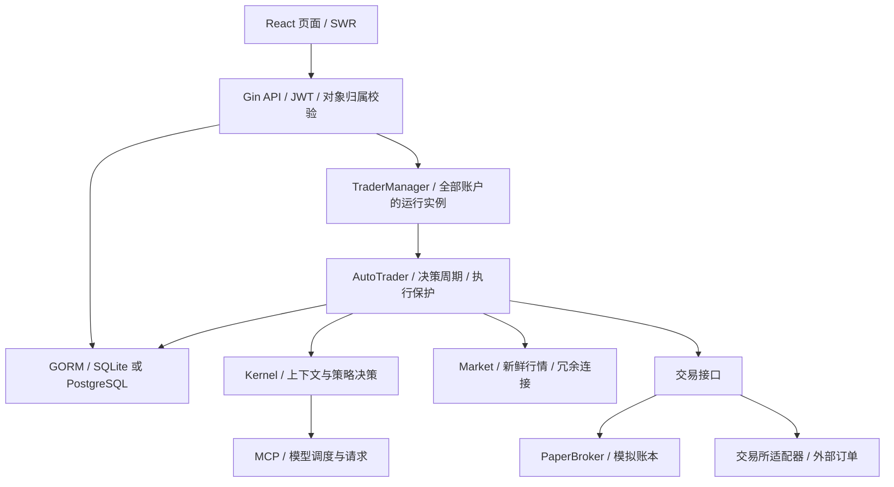

# NOFX 项目分析与优化落地记录

日期：2026-09-12。分析对象：当前 `dev` 工作区，起始 HEAD 为 `42646ccf`。

本文记录第一轮 API/store/web 改造。第二轮交易执行与行情生命周期的实际改造、验证边界和后续交易系统建议，见 [交易系统专项记录](TRADING_SYSTEM_REVIEW_2026-09-12.zh-CN.md)。

## 结论与范围

最值得优先投入的是账户归属、请求生命周期和高频读取。项目已经有交易执行层、策略引擎、行情提供者、模型客户端、存储与前端的模块分工；本轮发现的主要问题发生在这些模块交接处：SQL 执行成功被当成对象授权成功、正常关闭被当成启动失败、同一份页面数据使用多个缓存入口。

本轮完成四组本地改造：账户隔离与删除原子性、仪表盘归属查询、HTTP 关闭行为、前端 trader 列表去重。验证使用临时 SQLite、测试 HTTP 服务和前端 mock，不读取业务数据库，不启动交易系统。起始工作区已有 `trader/`、`kernel/` 的交易保护和 Paper 风控改动，本轮未改动这些文件，也未提交、推送或部署。

这是代码审查、隔离回归与本机基准结果；未测量线上 P95、真实交易所延迟、生产 goroutine 数或交易收益。

## 架构与关键边界



入口与依据：`main.go:102` 创建并加载 manager；`api/server.go` 注册公开与受保护路由；`manager/trader_manager.go:29` 持有全局 trader map；`trader/auto_trader_loop.go` 组织决策周期；`store/trader.go` 管理持久化配置；`web/src/router/AppRoutes.tsx` 组织页面数据。

应保留的设计包括 Paper/Live 分离、代码层订单限制、行情新鲜度与失败关闭机制。本轮没有通过扩大行情 TTL、吞掉依赖错误或调整交易参数来制造“更快”的表现。当前数据库已存在 WAL/连接配置优化，继续投入前应先测查询和锁等待，避免重复调参。

## 已落地改造

### 1. 账户隔离与删除事务：优先级最高

原 `TraderStore.Delete(userID, id)` 先按 trader ID 删除权益快照，再按 `id AND user_id` 删除 trader。其他账户的 ID 会导致 trader 行保留、权益历史已删除；SQL 删除零行还会返回成功，使 API 继续访问、停止或移除全局 runtime。

同类边界存在于 prompt、competition 更新：SQL 有用户过滤，但零行更新没有错误，handler 仍会按 ID 修改全局实例。Grid risk 读取原先没有所属账户检查。

现在的行为：

- 删除先确认 owner-scoped 删除确实命中记录，再清理权益；两步处于同一事务，任一步失败都回滚。
- 所有 trader 更新与删除检查 `RowsAffected`，没有所属记录时返回 `gorm.ErrRecordNotFound`。
- delete、prompt、competition 对不存在和不属于调用者的 ID 统一返回 404，在进入 manager 前退出；数据库故障仍返回 500。
- grid risk 先执行所属账户查询，再读取 runtime。

实现文件：`store/trader.go`、`api/trader_access.go`、`api/handler_trader.go`、`api/handler_trader_config.go`、`api/handler_trader_status.go`。

验收：修复前测试复现了对方权益记录从 2 条变为 1 条、零行变更返回 nil、关联清理错误被忽略。修复后，双账户越权/不存在 ID、合法重复配置更新、删除失败回滚、合法删除只影响目标账户均通过。API 测试用不可访问的 manager 验证越权请求必须在任何 runtime 调用前结束。

兼容性变化：store 调用方现在能收到“记录不存在”错误，不再把零行更新当成功；合法重复更新仍成功。没有数据库结构迁移。事务回滚在 SQLite 验证，未连接 PostgreSQL 实例验证。

### 2. 高频归属查询：只读取所需记录

原 `getTraderFromQuery` 每次加载用户全部 trader，随后线性查找。account、positions、status 等页面轮询会反复走这条路径。

新增 `GetForUser(userID, traderID)` 和 `GetLatestForUser(userID)`，分别用于明确 ID 与默认选择。查询始终包含用户过滤；默认仍选择创建时间最新的一项。runtime 缺失时原有加载行为保留。

隔离基准：Apple M1 Pro、Go 1.26.5、SQLite 内存库、同一用户 1,000 条 trader，`-benchtime=300ms`，单次运行：

| 查询方式 | 每次耗时 | 每次内存分配 | 分配次数 |
|---|---:|---:|---:|
| 原路径：加载 1,000 条 | 7.762 ms | 935,055 B | 43,136 |
| 新路径：读取指定 1 条 | 0.0325 ms | 7,899 B | 161 |

这是放大数据量的查询基准，不能外推为页面快 238 倍。实际用户 trader 较少或上游请求占主导时，端到端改善会更小。API 回归额外验证明确 ID 和默认选择均只执行一次 trader 查询、读取一条记录，并继续拒绝其他账户的 ID。

### 3. HTTP 正常关闭不再触发 fatal

原 `Server.Start()` 直接返回 `ListenAndServe()` 的错误，`main.go:137` 对所有错误执行 `Fatalf`。HTTP 正常关闭会返回 `ErrServerClosed`，可能在主流程执行完 `Shutdown`、`StopAll` 和数据库 defer 前退出。[Go 官方关闭约定](https://pkg.go.dev/net/http#Server.Shutdown)也要求等待关闭流程完成。

现在在构造阶段初始化 `httpServer`，避免 Start goroutine 与 Shutdown 竞争指针，也保留提前关闭状态；Start 仅把 `ErrServerClosed` 转为正常返回，真实监听错误继续上报。

验收包含活动请求排空、启动前关闭、错误监听地址三条路径，并运行竞态检测。本轮没有启动生产进程测试 SIGTERM，也没有调整交易器停止语义。

### 4. 前端 trader 列表共享与用户隔离

原 `/traders` 路由和页面分别用 `traders-route`、`traders` 每 5 秒请求同一个 `/api/my-traders`，SWR 无法合并；dashboard 又有独立 key。

新增 `useMyTraders`，以 `['my-traders', user.id]` 作为缓存 key。路由层只订阅，页面保留 5 秒轮询；dashboard 复用该缓存，保留 10 秒轮询和静默错误设置。原有 bound `mutateTraders()` 会同步所有消费者。关闭额外错误重试，由既有轮询节奏继续刷新。

四项回归覆盖：同时挂载只发一次请求、10 秒内两轮刷新只增加两次请求、页面 mutate 同步路由、切换账号隐藏旧列表及无会话不请求。本轮只隔离 trader 列表缓存，其他私有数据缓存仍列入后续治理。

## 后续实施建议

按风险和依赖顺序推进，避免一次扩大到全部交易所与全部前端数据层。

| 优先级 | 已确认的代码问题 | 建议实施方式 | 完成标准 |
|---|---|---|---|
| P1 | 决策 batch 不接收 cycle context，逐笔仅检查 running：`trader/auto_trader_loop.go:309`、`:322` | 把 context 传到 batch，在每笔动作和下单边界检查 deadline；随后逐个为外部订单 API 接入 context。与当前交易保护改动一起审查 | 阻塞第一笔并使 cycle 过期，释放后不得发起后续订单；已发出订单须对账，不因取消盲目重试；紧急平仓使用独立保护期限 |
| P1 | 账户状态 cache miss 无并发合并；8 秒外层超时不取消内层 probe：`api/exchange_account_state.go:112`、`:130` | 按用户合并刷新，给读请求传播 context 和总预算；缓存失效增加版本，防止旧探测覆盖新配置。可使用已有 x/sync 的请求合并能力 | N 个同用户 miss 每个 exchange 只探测一次；不同用户互不串数据；取消能到达底层；失效期间的旧结果不回写 |
| P1 | 当前终端的 OrderBook REST 轮询无 in-flight/取消控制 | 第二轮已为实际路由中的 OrderBook 加入门禁和 AbortSignal。原先列出的 AdvancedChart 属于旧页面组件，不在当前终端路由中，不能当作当前页面的性能瓶颈 | 慢请求不重叠、切换交易对及卸载时取消、旧响应不写入新盘口，见第二轮验证 |
| P2 | 行情 registry 按首次访问持续创建流，无闲置淘汰：`market/coinank_depth_stream.go:64` | 给 runtime 明确 owner context/Stop，按引用或 lastRequested 回收，保持 fresh/reconciled 契约 | fake connector 下创建、复用、淘汰可计数；取消后连接和 goroutine 退出，不影响其他 symbol |
| P2 | 其他私有 SWR key 与登录状态分离：`web/src/router/AppRoutes.tsx`、`web/src/contexts/AuthContext.tsx` | 逐步统一用户缓存空间与对应 bound mutate；一并处理页面本地 selectedTraderId，不只机械改 key | A→B 登录切换、退出和晚到响应测试均不显示 A 的账户/仓位/决策 |
| P2 | 大页面静态导入，初始 JS 较大；历史统计接口多次加载历史仓位 | 前端按路由 lazy，并设置实际首屏资源预算；存储先基准统计调用，再选择单次快照复用或 SQL 聚合 | 使用冷缓存测首屏资源和交互时间；收益/手续费/空数据/方向统计与原逻辑一致，记录查询次数与内存变化 |
| P2 | CI Go 版本来源不统一，部分测试为 advisory；旧架构文档引用已退出主路径的模块 | workflow 使用 `go-version-file: go.mod`，区分阻断检查与报告；给历史文档标明适用版本，更新架构入口 | 新环境按仓库版本构建；故意失败的必需测试确实阻断；文档引用能定位当前实现 |

补充判断：同一 connector 传两次会分别 Dial，当前双路是两条连接，不能描述成“共享同一连接”；它也不能证明出口故障域独立。`GetComparisonData` 虽持全局锁做 I/O，但当前路由使用的是已释放锁的 `GetCompetitionData`，因此本轮没有将孤立旧方法当成线上性能瓶颈。

## 验证与交付边界

可复现命令（仓库根目录，前端命令在 `web/`）：

```sh
go test ./... -run '^$' -count=1
go test -race ./api ./store -count=1
go test ./store -run '^$' -bench '^BenchmarkTraderOwnerLookup$' -benchmem -benchtime=300ms
go vet ./...
git diff --check
```

```sh
npm test -- --maxWorkers=2
npm run build
npx eslint src/hooks/useMyTraders.ts src/hooks/useMyTraders.test.tsx
```

- 全后端测试包编译、API/store 包测试及 race、全仓 Go vet、新 hook ESLint 均通过。
- 前端 30 个文件、186 个测试通过。一次与多个后端检查并发的默认 worker 运行发生 12 个 5 秒超时；当时系统 swap 已使用约 12 GB。其他检查结束后以 2 workers 重跑全量通过，未增加测试超时或修改相关组件。
- 前端 TypeScript 与 Vite 生产构建通过。主 JS 为 1,514.39 kB（gzip 440.27 kB），与基线相近；本轮未做代码分包。既有 Browserslist 数据过期与大 chunk 提示仍存在。
- 未运行全部后端测试函数、真实交易所/模型集成测试、生产停机演练或 PostgreSQL 回归。编译通过不能替代这些验收。
- 本轮修改集中在 API/store/web，新增相应测试与本文；未增加依赖、迁移或修改业务配置。发布前应从明确批准的代码范围构建，并按 `agents.md` 执行备份和业务验证，不能直接发布夹带既有交易改动的整个工作区。
